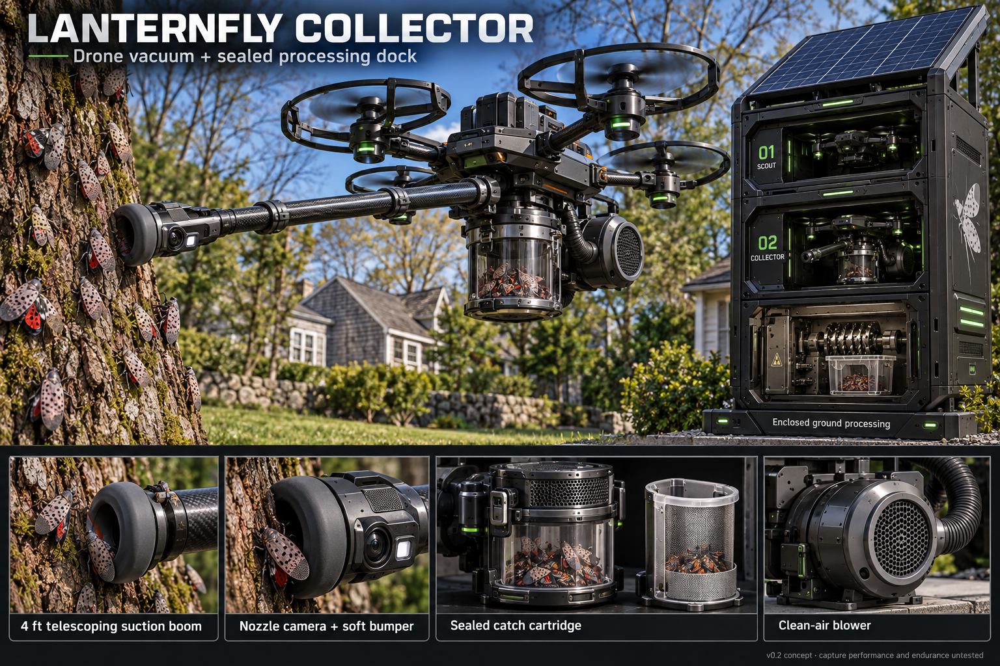

# Lanternfly Collector v0.2

Our old Mosquito Reaper concept has a new assignment: **spotted lanternflies.**

Meet **Lanternfly Collector v0.2**—a proposed drone system with a telescoping vacuum boom providing **four feet of reach**, a nozzle camera, and a sealed collection cartridge.

The mission: locate clusters, confirm targets, collect insects, and return to the dock for inspection and enclosed processing. The catch stays upstream of the blower.

**The drone collects. The dock processes.**

This is an early design concept. Next come ground tests for capture effectiveness, unintended catches, and clogging—followed by flight testing to see how that long boom behaves.

One old design. One very timely new job.

#Robotics #SpottedLanternfly #ConceptDesign
